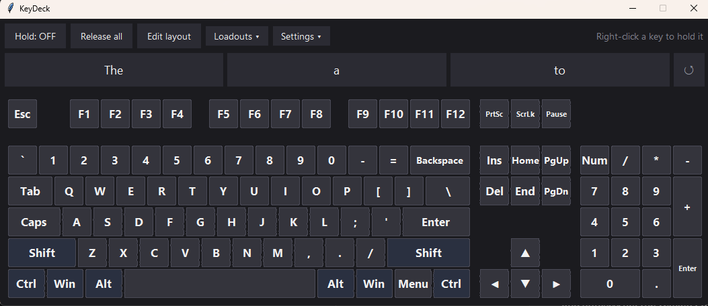
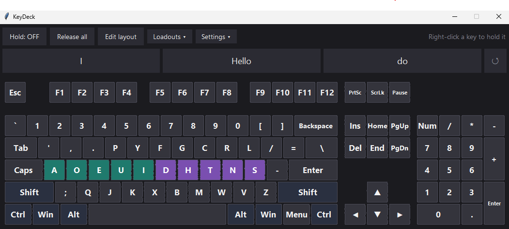
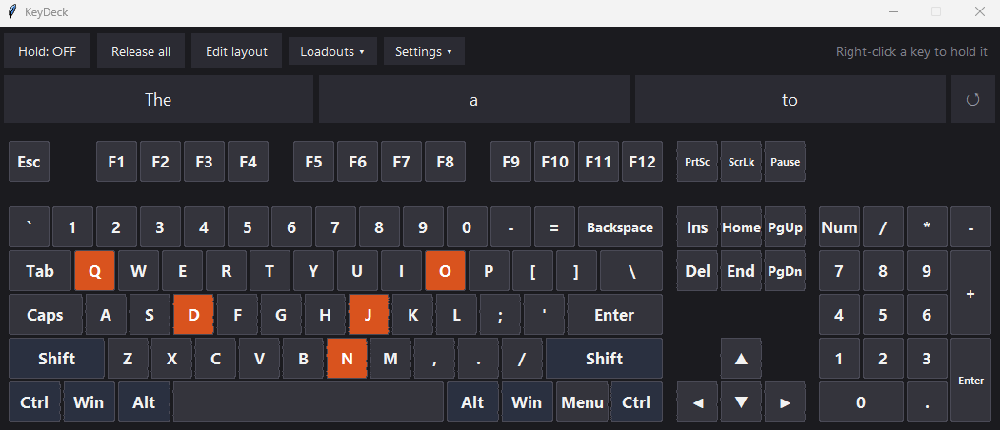

# KeyDeck Plus

**A fully customizable on-screen keyboard that types into any program, built with accessibility in mind.**

KeyDeck is built around one idea: your keyboard should be whatever you need it to be. Build the layout you want, save it as a loadout, program each button to send a key, a whole shortcut, a macro, a mouse click, a spoken phrase or a picture, and scale the whole thing to a size that suits you. Hold down any key, and let KeyDeck learn the words you use as you type. It never takes focus from the program you're typing into.

**KeyDeck Plus** adds everything that makes it usable without a physical keyboard or a fast hand: swipe typing, dwell typing, switch scanning, speech, picture keys, high-contrast themes and shareable layouts.

<p align="center">
  <br>
  <em>The default KeyDeck layout: main keys, navigation cluster and numpad, plus a predictive text bar.</em>
</p>

## Why KeyDeck

Most on-screen keyboards are a fallback: a fixed layout you can't change, with a few settings added on. But for many people the keyboard is the thing standing between them and the computer, and the right shape for it depends on how they move, see, hear and communicate. A layout that works for one person can be unusable for the next.

KeyDeck starts from the opposite idea: the keyboard should fit the person, not the other way around. It tries to put as many accessibility options as possible in one free program, so that whichever way you can reach a computer, there is a way to type with it:

- **If you can use a mouse but not a physical keyboard**, you get big or small keys wherever you want them, swipe typing, predictive text, macros and one-click shortcuts.
- **If clicking is hard**, you get dwell typing, mouse keys and a minimize tab that reopens without a click, enough to type and browse the web without pressing a mouse button.
- **If you use a single switch**, you get row-column scanning with layouts made for it.
- **If you need high contrast or large print**, you get high-contrast themes, a custom background color, and an interface that scales from tiny to extra large.
- **If speaking is difficult**, you get keys that speak phrases, picture keys, and linked layouts for communication boards, with captions that show what was said.

Everything runs and is stored on your computer: layouts, settings and the words KeyDeck learns. There is no account to make and nothing to sign in to.

KeyDeck is still growing, and it is shaped by the people who use it. If a feature would make your day easier, or something gets in your way, please [open an issue](../../issues) and say so. Feedback from people who rely on assistive technology is the most valuable kind.

## What makes KeyDeck different

| | |
|---|---|
| [Build your own layout](#build-your-own-layout) | Move, resize, recolor, outline, add and delete keys, or start from a blank board |
| [Loadouts](#loadouts) | Save any number of layouts, switch in a click, and import or export them to share. Includes [scaling and opacity](#scalable-interface) and [themes and colors](#themes-and-colors) |
| [Programmable keys](#programmable-keys) | Send any key, a shortcut, a macro, a mouse click, a layer switch or a spoken phrase |
| [Predictive text and autocorrect](#predictive-text-and-autocorrect) | Suggestions that learn your words, with smart capitals and punctuation |
| [Hold any key](#hold-any-key) | Letters, numbers, F-keys, everything, not just Shift, Ctrl and Alt |
| [Swipe typing](#swipe-typing) | Drag or click-glide-click across the letters to type a word |
| [Dwell typing](#dwell-typing) | Rest the pointer on a key and KeyDeck clicks for you |
| [Mouse keys](#mouse-keys) | Clicks and scrolling on the keyboard itself |
| [Click-free browsing](#click-free-browsing) | Dwell typing, layer keys, mouse keys and the minimize tab working together |
| [Switch scanning](#switch-scanning) | Row-column scanning for a single switch, with layouts built for it |
| [Speech and captions](#speech-and-captions) | Speak each word you type, or a whole phrase from one key, with on-screen captions |
| [Communication boards](#communication-boards-and-dialogue-trees) | Linked layouts of spoken phrases and picture keys, for AAC users |
| [Pictures and animation](#pictures-and-animation) | Put photos, drawings and animated GIFs on keys |
| [Types anywhere](#types-anywhere) | Works with games and apps, without stealing focus |
| [First-run setup](#first-run-setup) | Choose how you type the first time you open it, with warnings for features that don't go together |

---

## Build your own layout

The layout is not fixed. Switch on **Edit layout** and shape the keyboard however you like.

- **Move** keys by dragging them. They snap to a grid so everything stays tidy.
- **Resize** a key by dragging its bottom-right corner, or type exact width and height values.
- **Recolor** each key and its text individually, or reset it to the default.
- **Outline** each key with its own color and a thickness from 1 to 8 (0 means no outline).
- **Add** new keys, **duplicate** existing ones, and **delete** the ones you don't need.
- **Clear all** empties the board, and **Blank layout** in the Loadouts menu starts a new one from scratch.

Start from the full default keyboard (main keys, navigation cluster and numpad) and rearrange it, strip it down to a handful of big keys, or build something entirely your own.

<p align="center">
  <br>
  <em>A Dvorak-style arrangement with the home row recolored. Every button sends the key it shows.</em>
</p>

<p align="center">
  <br>
  <em>Just the letters A to Z, resized and recolored from red to violet.</em>
</p>

## Loadouts

A loadout is a saved layout, including every key's position, size, label, color, picture and what it sends, shortcuts included. Make as many as you need.

- **Save** the current layout, or **Save as** a new loadout under any name.
- Switch between loadouts from the **Loadouts** menu in one click, for example one for a game, one for writing, and one for a compact corner of your screen.
- KeyDeck remembers which loadout you used last and opens with it.
- Loadouts are plain JSON files in `%APPDATA%\KeyDeck\loadouts`. The **Open loadouts folder** menu item takes you straight there.
- **Reset to default layout** brings back the built-in keyboard whenever you want a fresh start.

### Share layouts

- **Export this layout** saves the layout on screen as one file you can send to someone. **Export all layouts** bundles every loadout into a single file.
- **Import layouts** reads one or more of those files. If you already have a layout with the same name you can replace it, keep both, or skip it.
- Pictures travel inside the file, so an imported layout looks exactly like the original. Nothing else has to be sent along with it.
- Imported files are checked key by key; anything malformed is dropped rather than trusted. If a file contains keys that press other keys for you (macros and shortcuts), KeyDeck shows them and asks before importing.
- Layer keys find their target layouts by name. When importing a set of linked layouts, choose **replace** rather than **keep both** if you already have layouts with the same names, or the links will point at the old copies.

### Example loadouts

The [`example loadouts`](example%20loadouts) folder has ready-made layouts to import and learn from:

| Layout | What it shows |
|---|---|
| `Demo - Macros` | One-button phrases and key sequences |
| `Demo - Mouse keys` | Click, double-click, middle-click and scrolling |
| `Demo - Layers Home / Numbers / Symbols` | Layer keys switching between layouts |
| `Demo - Number pad`, `Demo - Shortcuts`, `Demo - Gaming` | Typical layouts for other jobs |
| `Demo - Colors and outlines` | Per-key colors and outline thickness |
| `Scan - Letters / Numbers and symbols / Editing` | Large-key layouts made for [switch scanning](#switch-scanning) |
| `Talk - ...` (23 layouts, in `dialogue tree`) | A linked [dialogue tree](#communication-boards-and-dialogue-trees) of spoken phrases |
| `Core words - Picture board` and `Core words - Animated board` | A 6x6 [picture communication board](#communication-boards-and-dialogue-trees) |
| `Adobe Illustrator - Shortcuts` | 87 keys for Illustrator's default Windows shortcuts: tools, color, arranging, editing, view and file, grouped by color |
| `NoteDeck - Keyboard entry` | One key per note and length (C to B with sharps and flats, ½ to 4 beats), rests, octave keys, and play, edit and navigation keys, for a music app that needs a length key held while the note is pressed |
| `Test - Pictures` | Still and animated pictures, for checking that import works |

To try one, choose **Loadouts → Import layouts**, pick the file, and switch to it. The `KeyDeck example layouts (all in one)` file imports every demo at once, and `KeyDeck dialogue tree (all in one)` imports the whole dialogue tree.

### Scalable interface

KeyDeck can be as big, as small and as see-through as you want. The **whole interface scales together**, not just the keys.

- Choose **Tiny, Very small, Small, Medium, Large or Extra large**, or enter a **custom size** from 14 to 80 pixels.
- The toolbar buttons, menus, suggestion bar, caption bar and editing panel all grow and shrink with the keys, so nothing looks out of proportion.
- Key labels shrink and trim themselves to fit, so text never spills over neighboring keys at small sizes.
- **Opacity** can be set to 100%, 90%, 80%, 70% or 55% under **Settings**, so you can see the window or game behind the keyboard.
- Pin KeyDeck **always on top** so it stays within reach.

<p align="center">
  <br>
  <em>The same keyboard at a small size (top) and a large size with reduced opacity (bottom), showing the desktop through it.</em>
</p>

### Themes and colors

- **Colour theme**: Dark (default), **High contrast: black and yellow**, or **High contrast: white and black**.
- **Background color** changes the color behind the keys, toolbar and suggestion bar. **Reset background color** puts the theme's own back.
- Per-key colors, text colors, outline colors and outline thickness all still apply on top of any theme.

<p align="center">
  <br>
  <em>A high-contrast theme.</em>
</p>

## Programmable keys

Every button on KeyDeck is programmable. A button is a position, a size, a label and **what it sends**, and you can change each of those independently.

**Send any key.** Open **Edit layout**, select a button, and pick from the **Sends** list of 120+ keys: letters, numbers, punctuation, F1 to F24, arrows, the navigation cluster, the numpad and media keys. Give the button any **label** you like, and an optional **shift label** that appears while Shift is active.

**Program a shortcut.** Select a button and click **Program shortcut...** to make it send a combination of keys with one click. Type the shortcut with `+` between keys:

| You type | What the button does |
|---|---|
| `Ctrl+Shift+Esc` | Opens Task Manager |
| `Alt+F4` | Closes the active window |
| `Win+D` | Shows the desktop |
| `Ctrl+C` / `Ctrl+V` | Copy and paste |
| `Win+Shift+S` | Starts a screenshot snip |

You can combine Ctrl, Shift, Alt and Win with any other key, and common names like `Esc`, `Del`, `PageUp` and `Return` work too. KeyDeck checks what you type and tells you if it doesn't recognize a key. Windows blocks software from generating Ctrl+Alt+Delete, so KeyDeck won't accept that one.

**Program a macro.** **Program macro...** makes one button type a phrase or run a sequence of keys. Plain text is typed as written; put keys and waits in braces:

```
Thanks for your help!{Enter}
{Ctrl+A}{Ctrl+C}{Wait 300}{Alt+Tab}{Ctrl+V}
{Ctrl+Z x3}
```

For programs that need one key held while another is pressed, `{Hold 3}` presses a key and keeps it down until `{Release 3}`. For example, `{Hold 3}{Wait 30}{A}{Wait 30}{Release 3}` holds 3 while it taps A. If you stop a macro part-way, KeyDeck lets go of anything it was holding.

**Mouse keys.** Left, Right, Middle and Double click, plus Scroll Up and Scroll Down, are in the **Sends** list. See [Mouse keys](#mouse-keys).

**Layer keys.** **Layer key...** turns a button into a switch to another loadout, either until you switch back or for just the next key press (handy for a one-key Shift or symbols layer). Layers can lead to other layers, so you can build whole menus of layouts.

**Speak keys.** **Program speech...** makes a button say a phrase out loud. See [Speech and captions](#speech-and-captions).

**Picture keys.** **Picture...** puts a photo, drawing or animated GIF on a button. See [Pictures and animation](#pictures-and-animation).

<p align="center">
  <br>
  <em>A board made entirely of programmed shortcut buttons: Copy, Paste, Alt+Tab, Task Manager and more, each one click.</em>
</p>

## Predictive text and autocorrect

A suggestion bar above the keys offers predictions as you type, and it gets better the more you use it.

- **Completes words** as you type them, and **suggests the next word** between words.
- Choose **1 to 8 suggestions** under **Settings → Predictive text → Number of suggestions**.
- Starts with a built-in vocabulary of common words and starter phrases, so it is useful from the first keystroke.
- **Learns from you.** It remembers the words you use, which words tend to follow each other, and the phrases you repeat. A new word is only learned after you've typed it twice, so typos and one-offs don't pollute your suggestions. Words are learned in lowercase, so starting a sentence with "Tree" doesn't make "Tree" the suggestion from then on.
- Click a suggestion to type it. **Right-click** one to make KeyDeck forget that word. Use **Forget everything** in Settings to start over.
- Everything it learns stays on your computer, in a single file in `%APPDATA%\KeyDeck`. Nothing is sent anywhere.
- It knows when you're gaming, not writing. Held keys pause suggestions, so your game controls are never learned as words.
- Turn **Predictive text bar** off and the bar disappears completely.

**Autocorrect** (off by default) comes in two strengths: *Gentle* fixes only obvious typos, and *Standard* also adds apostrophes (dont → don't). Right-click Backspace straight after a correction to undo it.

**Smart capitals and punctuation** capitalize the first word of a sentence and the word "I", and keep punctuation attached to the word before it.

<p align="center">
  <br>
  <em>After typing "the q" into a text editor, KeyDeck offers "quick", "quickly" and "quite". Click one to finish the word.</em>
</p>

## Hold any key

Most on-screen keyboards let you latch Shift, Ctrl and Alt and nothing else. KeyDeck lets you hold **every** key.

- **Right-click** any key to hold it down. Right-click it again to release it.
- Switch on the **Hold** button in the toolbar and every ordinary left-click becomes a hold toggle instead of a tap.
- **Release all** lets go of everything at once, so nothing is ever left stuck down.
- Held keys are shown in orange so you can see at a glance what is down.

This is handy for any game or tool where you hold a key while doing something else, such as holding `A` while clicking to collect crops all at once, holding `W` to walk, or holding Shift while you work with the mouse.

Modifier keys (Shift, Ctrl, Alt, Win) behave the way you'd expect from an on-screen keyboard: a single click applies to the next key and then releases, and right-click locks them down. You can switch that one-shot behavior off in Settings. When Shift is active, the number and symbol keys switch to their shifted characters so you can see what you'll get.

<p align="center">
  <br>
  <em>Five keys held down at the same time (Q, O, D, J and N), shown in orange.</em>
</p>

## Swipe typing

Type a word in one gesture across the letters, like on a phone.

- **Hold and drag.** Hold the mouse button on the first letter, drag over the rest of the word and let go.
- **Click-to-swipe.** For anyone who can't hold a button: click the first letter, glide over the other letters without holding anything, and click the last letter to finish. Choose a style under **Settings → Swipe typing**.
- Understands **contractions** (don't, I'm, they'll).
- With **Predictive text** on, other likely words appear in the suggestion bar so you can swap a wrong guess for the right one.
- **Right-click Backspace** deletes the whole last swiped word at once.
- A space is added after each swiped word (you can switch this off), and one-letter words such as "a" and "I" get their space too.

<p align="center">
  <br>
  <em>Swipe typing: one gesture per word.</em>
</p>

## Dwell typing

Switch on the **Dwell** button and KeyDeck clicks for you. Rest the pointer on a key, a suggestion, a toolbar button or a menu item and a ring fills; when it completes, the click happens. No mouse button needed.

- **Dwell time**: how long the pointer must rest before the click.
- **Steadiness**: how far the pointer may drift and still count as resting, for tremor or a shaky hand.
- **Repeat**: keep clicking for as long as the pointer rests.
- **Countdown ring**: show or hide the ring that fills as you wait.
- The **Dwell** button on the toolbar can be shown or hidden. It always works, so dwell can always be switched back on.

All of these are under **Settings → Dwell clicking**.

<p align="center">
  <br>
  <em>Dwell typing: rest on a key and the ring fills.</em>
</p>

## Mouse keys

Mouse keys put clicks and scrolling on the keyboard itself: **Left, Right, Middle and Double click**, plus **Scroll Up** and **Scroll Down**. Press a mouse key, move the pointer to the target and hold it still: the click fires after a short delay, which you can adjust under **Settings → Mouse keys**.

Add them to any layout from the **Sends** list in Edit layout, or import the `Demo - Mouse keys` example. Together with dwell typing they replace the mouse buttons entirely.

## Click-free browsing

Dwell typing, layer keys, mouse keys and the minimize tab work together so you can browse the web without pressing a mouse button. The example below shows the whole loop:

1. **Dwell typing** types the address or search into the browser.
2. A **layer key** switches KeyDeck from the letters to a layout of mouse keys, and another layer key switches back.
3. **Mouse keys** do the clicking and scrolling: choose Click, move the pointer onto the link and rest, and the click fires. Scroll Up and Scroll Down move the page.
4. The **Minimize** button hides the keyboard so the whole page is visible. Resting the pointer on the small tab it leaves behind brings the keyboard back, with no click needed.

<p align="center">
  <br>
  <em>Clickless browsing: dwell typing, a layer key to the mouse keys, mouse keys to click and scroll, and the minimize tab to get the keyboard out of the way.</em>
</p>

### The minimize tab

Dwell users often can't click to get the keyboard out of the way, so KeyDeck has a **Minimize** button on the toolbar. It hides the keyboard and leaves a small tab at the edge of the screen. **Resting the pointer on the tab brings the keyboard back, with no click needed** (a click works too).

- Choose which corner or edge the tab sits on, and how long you must rest on it, under **Settings → Minimize tab**.
- By default the wait matches your dwell time, with a minimum of half a second, so brushing past it doesn't open the keyboard.
- When the keyboard reopens, dwell clicking waits until the pointer has moved off that spot, so the key under the pointer isn't pressed by accident.

## Switch scanning

For people who use a single switch, KeyDeck can scan its own keys. Switch it on under **Settings → Switch scanning**. Your switch is a plain **left click** on the keyboard: click once to start, click again when the row you want is highlighted, then click again on the key. Right-click pauses.

- Scan speed, extra time on the first row or key, and how many passes before pausing are all adjustable.
- Rows are worked out automatically from your layout, and the suggestion bar is scanned as the last row.
- The example `Scan - ...` layouts use large keys, with the most common letters first so the fewest steps are spent on the keys you use most.

<p align="center">
  <br>
  <em>Row-column scanning: pick the row, then the key.</em>
</p>

## Speech and captions

- **Speak words.** Switch on **Settings → Speak words** and KeyDeck says each word aloud when you finish it, whether you typed it, swiped it or picked it from the suggestion bar. Speed and volume are adjustable.
- **Speak keys** say a whole phrase when pressed, even when Speak words is off. Select a key in Edit layout and choose **Program speech...**.
- **Caption bar.** A strip under the keys shows what was just spoken, so it is visible to people nearby, in screenshots and in recordings, and to anyone who can't hear. Turn it off under **Settings → Speak words**.
- Speech uses the Windows voice installed on your computer.

## Communication boards and dialogue trees

Speak keys, picture keys and layer keys combine into communication boards. The example layouts include two:

- **A dialogue tree** of 23 linked layouts. The home page offers Greetings, Questions, Answers, Feelings, Food and drink, Needs, Small talk and Goodbyes. Each one opens its own page, and some lead to deeper pages (Food and drink → Drinks, Needs → Health, and so on). Every page has a **Home** key in the same corner, and deeper pages also have a **Back** key.
- **A picture board of 36 core words** with an original picture on each key, color-coded by word type (people, actions, describing words, places and things, social words). A second version has every picture animated.

<p align="center">
  <br>
  <em>The dialogue tree: choose a topic, then a phrase. Each phrase is spoken aloud and shown in the caption bar.</em>
</p>

<p align="center">
  <br>
  <em>The animated core-words board: every key shows a picture that moves, and pressing it says the word.</em>
</p>

<!--
  VIDEO: GitHub only plays a video inline if it is uploaded through the web editor.
  To show the dialogue tree demo with sound here: edit this README on github.com, drag
  "speak dialogue tree .mp4" into the editor, and paste the link GitHub gives you on its own line
  in place of the line below.
-->
[Watch the dialogue tree demo with sound (MP4)](screenshots/speak%20dialogue%20tree%20.mp4)

### Built with AAC in mind

Augmentative and alternative communication (AAC) means tools and strategies that help people communicate when speech alone isn't enough. Boards like these are likely to be useful to AAC users, including people with severe expressive communication disorders who can't rely on speech to say what they want, need or feel.

- **A voice for every key.** Pressing a key speaks it aloud for the people in the room. The caption bar shows the same words on screen, so they can also be read.
- **Core words.** The core-words board is built on core vocabulary: a small set of very common words (I, go, more, help, yes, no) that appear in a large share of everyday speech and combine into many different messages. Keys sit in the same place every time, so the board can be learned through repetition, and the color bands by word type (people, actions, describing words, places and things, social words) help the eye find a word.
- **Pictures and motion.** Each word has a picture, so the board doesn't depend on reading. On the animated version, the pictures move in ways that hint at meaning: the eye looks side to side, the door swings open, the check mark draws itself.
- **Ready-made phrases.** The dialogue tree groups whole phrases by topic, so a full message takes two or three selections, and the pages that matter most, such as *I need help now!* and Health, are one topic away. A **Home** key in the same corner of every page, plus a **Back** key, means the user is never lost.
- **Many ways to reach the keys.** The same boards work with a mouse, [dwell typing](#dwell-typing), [click-to-swipe](#swipe-typing) and [switch scanning](#switch-scanning), so the access method can be chosen for the person rather than the board.
- **Personal.** Use **Program speech...** to change what any key says and **Picture...** to use real photos of the people, places and things in the user's life. Switch animation off if motion is distracting.

KeyDeck is not a clinical tool, and these boards are examples, not a prescribed vocabulary. Choosing an AAC system and its vocabulary is best done with a speech-language pathologist and the people who know the user best. The pictures included here are original drawings made for KeyDeck, not from a commercial symbol set.

## Pictures and animation

Any key can show a picture. Select a key in **Edit layout** and choose **Picture...**; **Remove picture** takes it away again.

- A key with a label shows the picture with the label as a caption underneath. A key with no label lets the picture fill the whole key.
- **Animated GIFs play on the keys**, as in the animated core-words board above. Switch animation off with **Settings → Appearance → Play animated pictures on keys** if motion is distracting; the pictures then show their first frame.
- Pictures are stored inside the layout, so exporting and importing carries them along.
- Installing the optional [Pillow](https://python-pillow.org/) package (`python -m pip install pillow`) adds JPG, BMP, WebP and other picture types, smooth scaling, and animation from other formats. Without it, KeyDeck still handles PNG and GIF files up to 400 KB.
- Large pictures are shrunk automatically to keep layout files a sensible size.

## Types anywhere

- **Never steals focus.** Clicking a key does not pull focus away from the program you're typing into, so keystrokes go where you were working.
- **Hardware scan codes** are sent by default, which is what most games listen for. You can switch to standard key events in Settings.
- Optional **auto-repeat** when you press and hold a key, just like a physical keyboard.
- The **Caps Lock** key lights up while Caps Lock is on, even if you turned it on from your physical keyboard.

---

## Getting started

KeyDeck Plus needs Windows and Python 3. Download or clone this repository and keep these two files together in one folder:

- `keydeck_plus.py`, the program
- `keydeck_words.py`, the word list used by autocorrect and swipe typing. Without it KeyDeck still runs, but autocorrect and swipe typing are unavailable.

```
python keydeck_plus.py
```

Optional: `python -m pip install pillow` for JPG and other picture types, smoother picture scaling and animation from other formats.

### First-run setup

The first time KeyDeck opens, a short setup asks how you want to type, so it starts the way that suits you:

- **Click with the mouse**, the standard way.
- **Swipe typing**, dragging over the letters (or click, glide, click).
- **Dwell typing**, resting the pointer on a key to type with no clicking. The setup window itself responds to dwell, so you can get through it without pressing a button.
- **Switch scanning**, for a single switch.

The second page sets the options for your choice (dwell or scanning speed, how you swipe), the key size and colors, and whether to read words aloud. It also lists the **recommended features**, which start switched on: predictive text, learning your words, gentle autocorrect, automatic capitals and tidy punctuation. If you untick one, the setup tells you what you'd be missing.

The last page explains the combinations that **don't go together**:

| Combination | What happens |
|---|---|
| Dwell typing + switch scanning | Can't be used together. Dwell would keep starting and choosing in the scanner. |
| Switch scanning + swipe typing | Can't be used together. Scanning picks one key at a time, so there is no path to follow. |
| Dwell typing + swiping by dragging | Dwell can't hold the button down, so swipe typing uses click, glide, click. |
| Swipe typing without predictive text | Not recommended. The other likely words are how you fix a wrong swipe. |
| Very quick dwell or scanning times | Not recommended. Under 0.7 s (dwell) or 0.6 s (scanning) is easy to trigger by accident. |

If you turn on one half of a clashing pair later in Settings, KeyDeck switches the other off and says why in the toolbar. It never uses a pop-up for this, so dwell and scanning users can't get stuck behind one.

Run the setup again any time from **Settings, Setup wizard**, and use **Settings, Restore recommended features** to switch the recommended ones back on.

### Build an executable

```
python -m pip install pyinstaller
python -m PyInstaller --noconsole --onefile --name KeyDeckPlus keydeck_plus.py
```

Your program is created at `dist\KeyDeckPlus.exe`. If autocorrect or swipe typing is missing in the built program, add `--hidden-import keydeck_words` to the command.

## Good to know

- Windows blocks injected keystrokes into programs running as administrator unless KeyDeck is also run as administrator.
- Key codes assume a US keyboard layout.
- Settings, loadouts and learned words are saved in `%APPDATA%\KeyDeck`, so they survive updates and rebuilds. KeyDeck Plus uses the same folder as the original KeyDeck, so existing layouts and settings carry over.
- Spoken words use the Windows voice, and are spoken in password boxes too, so turn Speak words off when typing a password.
- Unsigned programs built with PyInstaller are sometimes flagged by antivirus software. Running `python keydeck_plus.py` directly avoids that.
